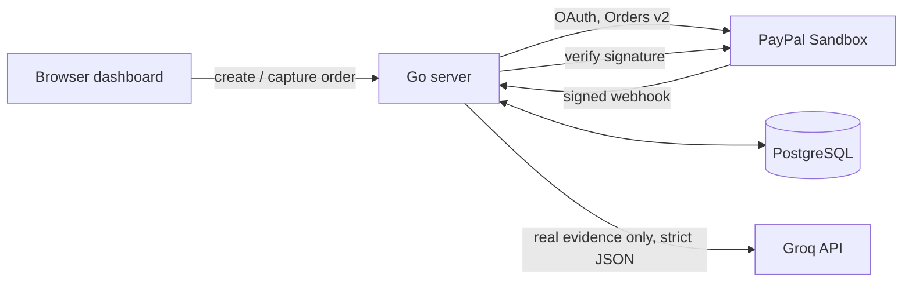

# PayPal Spend Intelligence Agent

A sandbox-first revenue-monitoring dashboard for small merchants. It brings PayPal Sandbox captures, signed webhooks, deterministic leakage checks, and evidence-grounded spend insights into one place, with a human in the loop for every action.

- **Live demo:** https://paypal-ai-auditor.onrender.com (free tier: the first load after idle can take about 50 seconds)
- **Demo video:** https://youtu.be/3Nml_QApt-Y
- **Status:** hackathon project, PayPal Sandbox only

## Problem and solution

Small merchants often notice payment problems only after the money is gone: duplicate captures, failed payments, fee surprises. They need to review activity and see the evidence, without treating an AI-generated answer as a financial decision.

This application records Sandbox payment attempts, receives signed PayPal webhooks, runs deterministic Go detectors over the recorded evidence, and presents findings and a Groq-generated summary in a browser dashboard. Detection is code, the LLM only explains real data, and every action needs a human.

The findings workflow is for review and record-keeping. Finding detection/seeding, action proposals, and approvals require the administrator's `ADMIN_TOKEN`; the browser prompts for it per operation and does not store it. Approval does not issue a refund or move money. Sandbox checkout creates and captures a test payment after the Sandbox buyer approves it; PayPal validates the buyer approval, and the checkout endpoints do not require the admin token.

## Architecture



## Technology

- **Backend:** Go 1.26.8 (see `go.mod`), `net/http`, PostgreSQL, `github.com/lib/pq`, `github.com/joho/godotenv`.
- **Frontend:** `static/index.html` with native JavaScript and CSS, Tailwind CSS via CDN, and AG Grid Community 32.3.3 via CDN.
- **Payments and webhooks:** PayPal Orders v2 Sandbox API and PayPal's webhook signature-verification API.
- **AI:** Groq chat completions using `openai/gpt-oss-20b`.
- **Database changes:** ordered SQL migrations run by `cmd/migrate`.
- **Hosting:** Render (web service and PostgreSQL).

## What the application does

1. A visitor can start a $25.00 USD PayPal Sandbox checkout. After the Sandbox buyer approves it, the application verifies the order status and amount before capture.
2. Payment attempts are recorded with outcomes. Capture requests use a deterministic `PayPal-Request-Id` and a PostgreSQL per-order advisory lock; an already-completed order is reconciled instead of captured again.
3. PayPal sends signed webhooks for capture events. They are verified, deduplicated, and recorded (see below).
4. Deterministic Go detectors inspect non-synthetic capture/webhook attempt data for duplicate captures and fee mismatches. The fee comparison uses a heuristic, not PayPal's full merchant-specific fee schedule.
5. The dashboard displays live leakage totals separately from an explicitly labeled synthetic demo finding. "Recovered" is an actioned finding status, not proof that a refund was sent.
6. The spend-insight endpoint sends matched, non-synthetic completed capture evidence to Groq and displays the returned insight and citations. With no evidence it returns "Not enough data yet" without calling Groq.
7. A read-only Webhook activity panel summarizes total received and processed events, events with a recorded processing error, and the most recently received event's type and timestamp. It never returns or displays webhook payloads.

## Safety boundaries

- **Detection is deterministic.** Go code decides whether duplicate-capture or fee-mismatch findings exist and calculates their amounts. The LLM only generates spend insight; it does not determine finding status, amounts, or finding explanations.
- **Evidence.** Findings record capture IDs and any corresponding order ID available from attempts. The repeated-persisted-capture detector looks up an order ID through related attempts. Demo findings use synthetic IDs and are labeled and excluded from live totals.
- **AI insight.** The model receives matched real completed capture evidence only, uses a strict JSON Schema response at temperature 0, and its cited order/capture pairs are checked against the supplied evidence. Results are cached for 60 seconds by evidence hash.
- **Write authentication.** Finding detection/seeding, action proposals, and approvals require `ADMIN_TOKEN` in the `X-Admin-Token` header and fail closed if the server token is unset. Checkout is not gated by this token; PayPal Sandbox handles buyer approval. The UI prompts for the token per operation and does not persist or log it. PayPal webhooks instead require signature verification. Read-only API endpoints are unauthenticated, and the shared token does not identify an individual human.
- **Action audit.** Action proposals and approvals only record state and audit events. They do not call PayPal, send a refund, or move money. Approval refuses an existing action whose audit reports `money_moved=true` (HTTP 409), and migration 005 adds a database-level check for the same rule.
- **Money representation.** Application payment and finding amounts use integer minor units. The legacy `captures.amount` column remains `DOUBLE PRECISION` for compatibility; `amount_minor` is used for current money calculations.
- **Sandbox only.** The payment flow targets PayPal Sandbox, not live payments.

## Webhook verification and deduplication

`POST /webhooks/paypal` reads and verifies the raw request body with PayPal's signature-verification API. It fails closed with HTTP 503 when `PAYPAL_WEBHOOK_ID` is unset, rejects invalid signatures, and accepts a signature only when PayPal returns `SUCCESS`.

Webhook receipts use `event_id` as a primary key. The handler inserts with `ON CONFLICT (event_id) DO NOTHING`, then locks the stored receipt with `SELECT ... FOR UPDATE`. Supported capture events (completed, denied, refunded) write their attempt and set `processed_at` in the same transaction. An already processed duplicate is acknowledged without another attempt. If processing fails, `processed_at` stays or is reset to `NULL`, an error marker is stored, and a later delivery can retry. Unsupported event types are stored and marked processed without writing an attempt.

Webhook payloads are persisted and may contain payer data. Do not use this endpoint with production payer payloads.

`GET /api/webhook-activity` returns only aggregate counts plus the last event type and received timestamp. It does not expose event IDs, processing-error text, webhook payloads, or payer data.

## Decline rate

Only `INSTRUMENT_DECLINED`, `PAYER_CANNOT_PAY`, and `PAYMENT_DENIED` count as declines. Other failures (for example `DUPLICATE_INVOICE_ID`, network errors, 5xx, unclassified) are failures, not declines. The denominator is real, non-synthetic capture attempts with succeeded, declined, or failed outcomes; reconcile attempts and `ORDER_ALREADY_CAPTURED` are excluded. With no attempts the card shows "No data yet". The reason codes come from Sandbox negative testing and do not establish production decline behavior.

## Setup

Use Go 1.26.8 or a compatible toolchain and a PostgreSQL database. Configure the variables below in a local `.env` file or the process environment. Keep credentials private and never commit `.env`.

| Variable | Required | Purpose |
|---|---|---|
| `DATABASE_URL` | Yes | PostgreSQL connection used by the app and migration runner. |
| `PAYPAL_CLIENT_ID` | Yes | PayPal Sandbox application client ID. |
| `PAYPAL_CLIENT_SECRET` | Yes | PayPal Sandbox application secret. |
| `GROQ_API_KEY` | No for startup | Groq API key; spend insight is unavailable without a valid key. |
| `APP_BASE_URL` | No for local development | PayPal return/cancel URL base; defaults to `http://localhost:8080`. Set it to the deployed URL when hosting. |
| `PAYPAL_WEBHOOK_ID` | Required for webhooks | ID of the webhook registered on your Sandbox app. The endpoint fails closed without it. |
| `ADMIN_TOKEN` | Required for findings/action writes | Long, randomly generated token. If unset, those endpoints refuse requests. Not needed for checkout. |
| `PORT` | No | HTTP listen port; defaults to `8080`. |

**1. Create the base table (fresh database only).** Start the app once (`go run .`) so it creates the original `captures` table, then stop it.

**2. Apply migrations** one at a time, in order, from the repository root. The runner accepts exactly one file and records it in `schema_migrations`, applying each migration and its tracking record in one transaction. Do not rely on shell wildcards:

```bash
go run ./cmd/migrate ./migrations/001_amount_minor.sql
go run ./cmd/migrate ./migrations/002_attempts.sql
go run ./cmd/migrate ./migrations/003_webhook_events.sql
go run ./cmd/migrate ./migrations/004_findings_actions.sql
go run ./cmd/migrate ./migrations/005_action_money_moved_check.sql
```

On Windows PowerShell, use backslashes (for example `.\migrations\001_amount_minor.sql`). Review migrations and target the intended database before running them. The findings and action routes need migration 004. Migration 005 is an additional database-level safeguard; the application's approval guard works without it.

**3. Register the webhook.** In your PayPal Sandbox app, add a webhook for `https://<your-host>/webhooks/paypal` subscribed to *Payment capture completed*, *denied*, and *refunded*. Put its Webhook ID in `PAYPAL_WEBHOOK_ID`.

**4. Start the application:**

```bash
go run .
```

### Migration 005

```sql
ALTER TABLE actions
    ADD CONSTRAINT actions_no_money_moved_after_proposal_check
    CHECK (NOT jsonb_path_exists(result, '$.**.money_moved ? (@ == true)')) NOT VALID;
```

The check rejects `money_moved=true` anywhere in an action's JSON result, for every status including `proposed`. `NOT VALID` means PostgreSQL does not scan existing rows when adding the constraint; new and updated rows must satisfy it.

## Tests and checks

```bash
gofmt -l .
go vet ./...
go test -race -count=1 -v ./...
```

PostgreSQL integration tests use only `PAYPAL_AI_AUDITOR_TEST_DATABASE_URL`. Without it they skip locally. In CI (`CI=true`) a missing test database fails the run, and CI applies all migrations to a disposable PostgreSQL service before testing. Never point the test URL at a real database. Unit tests mock all HTTP and never call PayPal or Groq.

## Demo

- **Live app:** https://paypal-ai-auditor.onrender.com
- **Video walkthrough:** yt link
- **Trying the approval flow:** seed the labeled demo finding, run the audit, then use its approve button. The UI prompts for the shared `ADMIN_TOKEN`; the token is provided to judges privately through the event's approved channel and is never in this repository. The button records a demo approval only. No refund is sent and no money moves.

## Limitations

- **Sandbox only.** Not suitable as a production merchant system.
- **Authentication is minimal.** Read-only endpoints are unauthenticated and checkout is not admin-token protected. Findings and action writes use one shared token that does not identify a specific approver.
- **Approval does not refund.** "Recovered" reflects an actioned status, not money returned.
- **Demo data is simulated.** The seeded finding and demo transactions are labeled synthetic and excluded from live metrics.
- **Decline reason codes come from Sandbox negative testing,** not real buyer or card declines.
- **Narrow scope.** One fixed $25.00 USD checkout, one merchant, and three handled webhook event types.
- **The AI insight is limited.** It summarizes real captures with citations, and can be generic when data is thin.
- **Stored webhook payloads may contain payer data.** Use Sandbox payloads only.
- **Free-tier hosting.** Render's free web service sleeps when idle (the first request can take 50 seconds or more), and free PostgreSQL instances expire.

## License

See [LICENSE](LICENSE).
