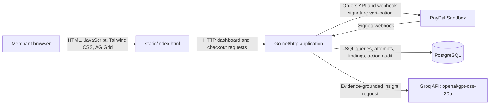

# PayPal Spend Intelligence Agent

A sandbox-first revenue-monitoring dashboard for small merchants. It brings PayPal Sandbox captures, deterministic leakage checks, and evidence-grounded spend insights into one place.

## Problem and solution

Small merchants need a practical way to review payment activity and spot possible duplicate captures or fee mismatches without treating an AI-generated answer as a financial decision. This application records Sandbox payment attempts, runs deterministic Go detectors over recorded evidence, and presents findings and a Groq-generated summary in a browser dashboard.

The findings workflow is for review and record-keeping. It does not issue refunds or move money. Separately, the PayPal Sandbox checkout flow creates and captures a test payment after the Sandbox buyer approves it.

## Architecture



### Technology

- **Backend:** Go 1.26.8 (`go.mod`), `net/http`, PostgreSQL, `github.com/lib/pq`, and `github.com/joho/godotenv`.
- **Frontend:** `static/index.html` with native JavaScript and CSS, Tailwind CSS via CDN, and AG Grid Community 32.3.3 via CDN.
- **Payments and webhooks:** PayPal Orders v2 Sandbox API and PayPal's webhook signature-verification API.
- **AI:** Groq chat completions using `openai/gpt-oss-20b`.
- **Database changes:** ordered SQL migrations run by `cmd/migrate`.

## What the application does

1. A buyer can create and approve a $25.00 USD PayPal Sandbox order. The application verifies the order status and amount before capture, then records the capture.
2. Payment attempts are recorded with outcomes. Capture requests use a deterministic `PayPal-Request-Id` and a PostgreSQL per-order advisory lock; an already-completed order is reconciled instead of captured again.
3. The deterministic Go detectors inspect non-synthetic capture/webhook attempt data for duplicate captures and fee mismatches. The fee comparison uses a heuristic, not PayPal's full merchant-specific fee schedule.
4. The dashboard displays live leakage totals separately from an explicitly labeled synthetic demo finding. “Recovered” is an `actioned` finding status, not proof a refund was sent.
5. The spend-insight endpoint sends matched, non-synthetic completed capture evidence to Groq and displays the returned insight and citations.

## Safety boundaries and known gaps

- **Detection is deterministic.** The Go detectors decide whether a duplicate-capture or fee-mismatch finding exists and calculate its amount. Groq does not decide finding status or amounts.
- **AI is limited to spend insight.** The model receives only matched real completed capture evidence, uses a strict JSON Schema response at temperature 0, and its cited order/capture pairs are checked against the supplied evidence. It does not explain the deterministic findings; their `explanation` may be empty.
- **Finding evidence is not guaranteed to contain both real IDs.** Finding evidence records capture IDs, and includes order IDs where available. In particular, the repeated-persisted-capture detector records the capture ID without an order ID. The demo finding uses synthetic IDs and is labeled and counted separately.
- **Approval is not authenticated.** The dashboard requires a user click before it sends its propose/approve requests, but API endpoints have no authentication or authorization and do not establish who approved an action.
- **Action APIs are record-only; they do not call PayPal or send a refund.** There is a current CI blocker: `TestPostgresDetectorsAndActionAudit` fails when a pre-existing proposed action has `money_moved=true` in its stored JSON result; the approval endpoint returned HTTP 200. The action workflow and audit invariant should not be considered verified until this is fixed and CI passes.
- **Money representation:** application payment and finding amounts use integer minor units. The legacy `captures.amount` database column remains a `DOUBLE PRECISION` column for compatibility; `amount_minor` is the integer-valued field used by current money calculations.
- **Sandbox only:** the payment flow targets PayPal Sandbox, not live payments.

## Webhook verification and deduplication

`POST /webhooks/paypal` reads and verifies the raw request body with PayPal's signature-verification API. It fails closed with HTTP 503 when `PAYPAL_WEBHOOK_ID` is unset and accepts a signature only when PayPal returns `SUCCESS`.

Webhook receipts use `event_id` as a primary key. The handler inserts with `ON CONFLICT (event_id) DO NOTHING`, then locks the stored receipt with `SELECT ... FOR UPDATE`. Supported capture events write their attempt and set `processed_at` in the same transaction. An already processed duplicate is acknowledged without another attempt. If processing fails, `processed_at` remains or is reset to `NULL`, an error marker is stored, and a later delivery can retry. Unsupported event types are stored and marked processed without writing an attempt.

Webhook payloads are persisted and may contain payer data. Do not use this endpoint with production payer payloads.

## Decline rate

Only `INSTRUMENT_DECLINED`, `PAYER_CANNOT_PAY`, and `PAYMENT_DENIED` count as declines. The denominator is real, non-synthetic capture attempts with `succeeded`, `declined`, or `failed` outcomes; reconcile attempts and `ORDER_ALREADY_CAPTURED` are excluded. The reason codes reflect Sandbox negative testing and do not establish production decline behavior.

## Setup

Use Go 1.26.8 or a compatible Go toolchain. Configure the following environment variables in a local `.env` file or in the process environment. Keep credentials private; do not commit `.env`.

| Variable | Required | Purpose |
|---|---|---|
| `DATABASE_URL` | Yes | PostgreSQL connection used by the app and migration runner. |
| `PAYPAL_CLIENT_ID` | Yes | PayPal Sandbox application client ID. |
| `PAYPAL_CLIENT_SECRET` | Yes | PayPal Sandbox application secret. |
| `GROQ_API_KEY` | No for startup | Groq API key; spend insight is unavailable without a valid key. |
| `APP_BASE_URL` | No for local development | PayPal return/cancel URL base; defaults to `http://localhost:8080`. Set it to the deployed app URL in Render. |
| `PAYPAL_WEBHOOK_ID` | No for startup; required for webhook verification | PayPal Sandbox webhook ID. The webhook endpoint fails closed when it is missing. |
| `PORT` | No | HTTP listen port; defaults to `8080`. |

The migration runner accepts exactly one migration-file argument and loads `.env` from the repository root. Run the migrations one at a time, in order, from the repository root. Do not rely on shell wildcard expansion:

```powershell
go run ./cmd/migrate .\migrations\001_amount_minor.sql
go run ./cmd/migrate .\migrations\002_attempts.sql
go run ./cmd/migrate .\migrations\003_webhook_events.sql
go run ./cmd/migrate .\migrations\004_findings_actions.sql
```

Migration 001 expects the legacy `captures` table to exist. The runner records applied migration filenames in `schema_migrations` and applies each migration and its tracking record transactionally. Review migrations and target the intended database before running them.

Start the application:

```powershell
go run .
```

## Tests and checks

```powershell
gofmt -l .
go vet ./...
go test -race -count=1 -v ./...
```

PostgreSQL integration tests use only `PAYPAL_AI_AUDITOR_TEST_DATABASE_URL`. Without that dedicated variable they skip locally; in CI they run against a disposable PostgreSQL service. Never point it at production.

## Demo

- **Live app:** [paypal-ai-auditor.onrender.com](https://paypal-ai-auditor.onrender.com)
- **Video walkthrough:** [Add video link](VIDEO_LINK_TBD)

## Limitations

- The application has no authentication or authorization on its API endpoints; it is not suitable as a production merchant system.
- Payments and webhook verification use PayPal Sandbox only. Sandbox negative-test reason codes do not prove production buyer behavior.
- Synthetic data is labeled and excluded from live metrics. The demo finding has synthetic order and capture identifiers.
- Stored webhook payloads may contain payer data; use Sandbox payloads only.
- Render free-tier services may cold-start after inactivity. The hosting plan and runtime behavior were not checked as part of this code verification.
- The action-audit CI failure described above remains unresolved. Do not treat action approval as submission-ready until the unsafe stored-result case is fixed and CI passes.
